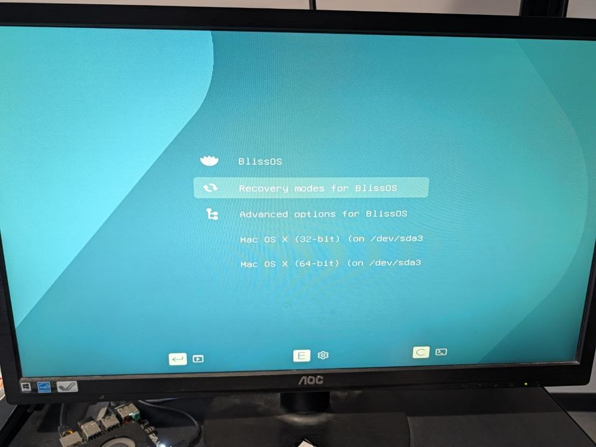
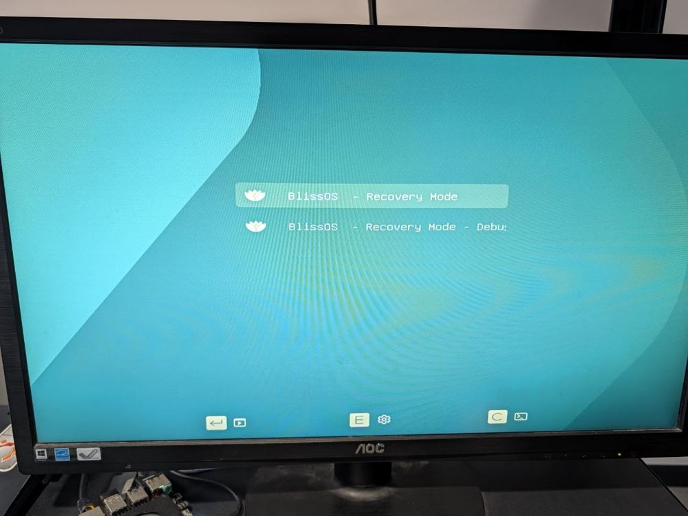
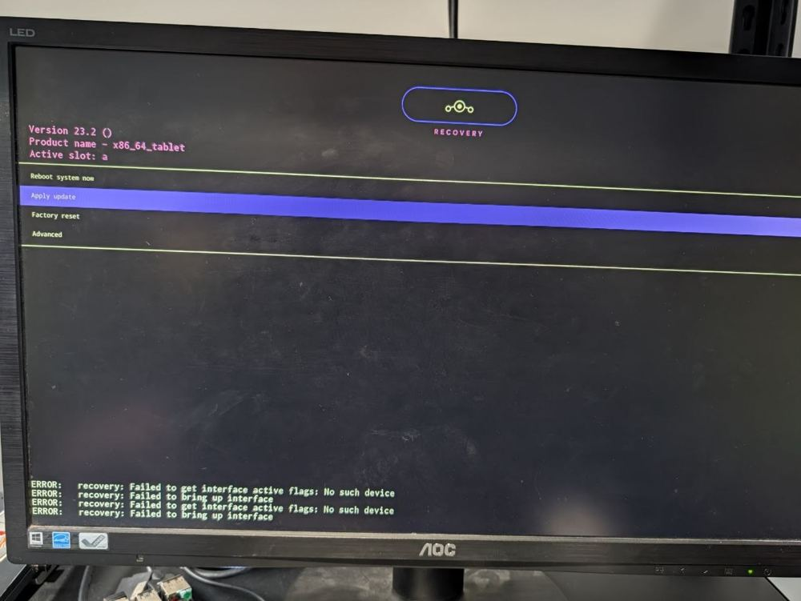
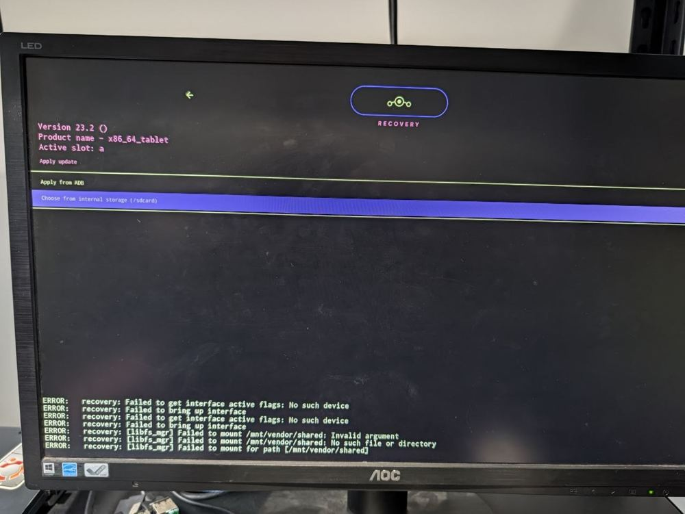
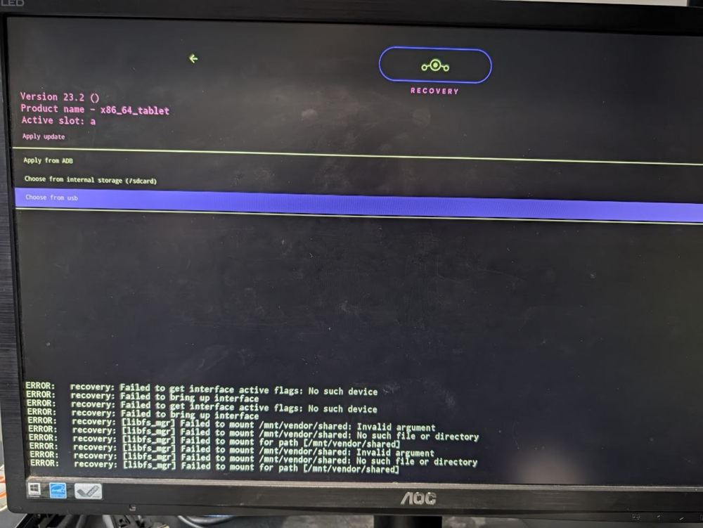
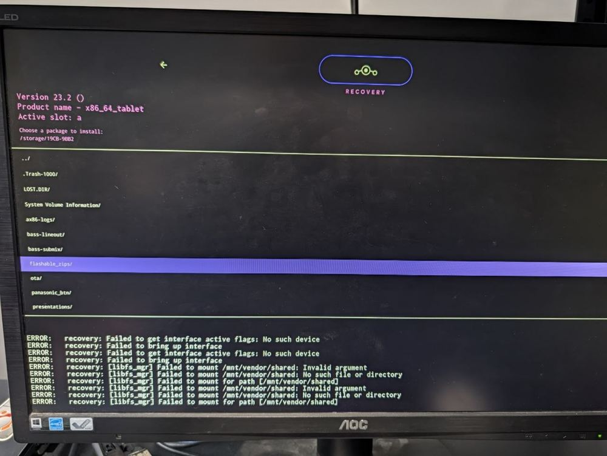
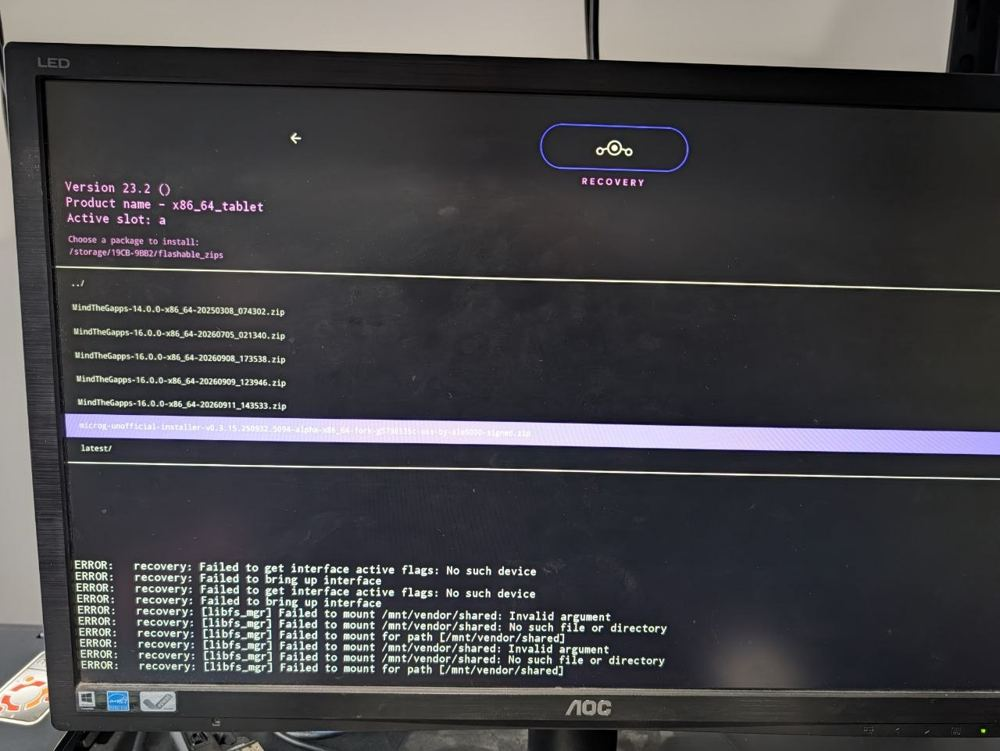
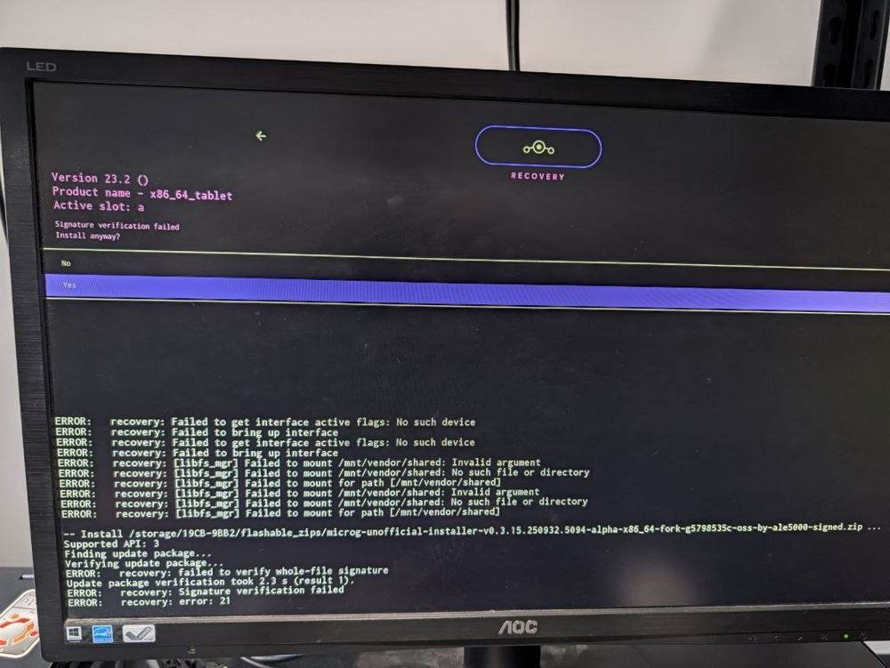
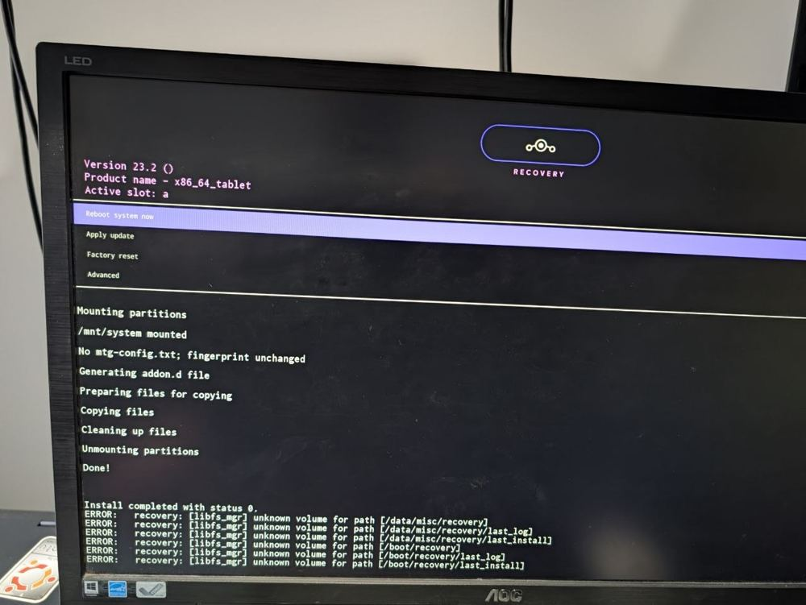
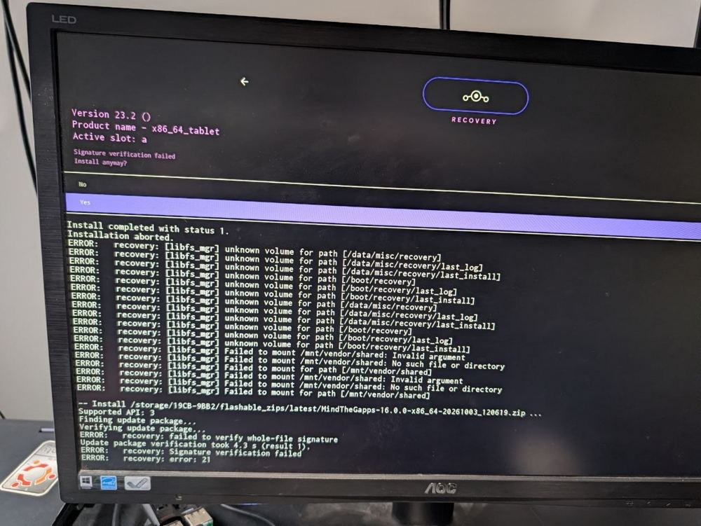

# Install a .zip file with Recovery

> **Android 16 Lineout.** These steps and photos were taken on **Bass: Lineout** (Lineage **23.2** / Android **16**).

Sometimes you get a **.zip file**: an update, a fix, or an add-on (Google apps, for example). You
can't open it like a photo or a document. It has to be installed from **Recovery**, a small repair
menu that starts *instead of* Android.

It takes about 5 minutes. Installing a .zip this way does **not** erase your apps or files
(unless the instructions that came with the file say so).

Go slowly and do one step at a time. Every step has a photo of what the screen should look like,
so you can check you're in the right place before you press anything.

## Before you start

You need:

- **The .zip file** (for example `MindTheGapps-16.0.0-x86_64.zip`). Write its name down: you'll
  look for it later.
- **A keyboard.** A USB keyboard, or the one built into your laptop. A Bluetooth keyboard will not
  work here.
- **Power.** Plug in the charger if your device has a battery.

Put the .zip file in one of these two places:

- **On the device itself (easiest).** Download it with the web browser on the device. It goes into
  the **Download** folder.
- **On a USB stick.** Copy it onto a USB stick with another computer, then plug the stick into the
  device **before** you start.

## The only keys you need

| Key | What it does |
|---|---|
| **Down arrow** / **Up arrow** | Moves the highlight (the purple or light bar) down or up |
| **Enter** | Chooses the highlighted line |
| **Backspace** or **Esc** | Goes back one screen |

Nothing happens until you press **Enter**. If you highlight the wrong line, just move again.

> **Don't worry about the "ERROR:" lines.** In Recovery, the bottom of the screen is always full
> of white lines starting with **ERROR:**. That's normal, even when everything works. Ignore them.
> The only lines that matter are the ones this guide tells you to look for.

## Step 1: Open the start menu

1. Restart the device the normal way (hold the power button, then **Restart**).
2. Watch the screen. Before Android starts, a **light blue screen with a short list** appears. This
   is the start menu.
3. As soon as you see it, press **Down arrow** once, so it doesn't start Android on its own.
4. Move the highlight to **Recovery modes for BlissOS** and press **Enter**.

Your list may have other lines too (like the two "Mac OS X" lines in this photo). That's fine.

> **Android started instead?** You missed the menu. That's very common. Restart again, and this
> time start tapping the **Down arrow** key as soon as the screen goes dark.

## Step 2: Choose "Recovery Mode"

A second, shorter list opens. Keep the highlight on the **first** line, **BlissOS - Recovery
Mode**, and press **Enter**. (Not the one that ends in "Debug".)

## Step 3: Choose "Apply update"

After a few seconds, the dark **Recovery** screen opens, with the Recovery logo at the top. Move
the highlight to **Apply update** and press **Enter**.

> **Stay away from "Factory reset".** It erases everything on the device. You never need it to
> install a .zip.

## Step 4: Choose where the file is

The next screen asks where your .zip file is:

- If you downloaded the file **on the device**, choose **Choose from internal storage (/sdcard)**.

  

- If the file is on a **USB stick**, choose **Choose from usb**.

  

Don't choose **Apply from ADB**. That one is for developers.

> **No "internal storage" line, or no "usb" line?** Some devices don't show internal storage
> here: put the .zip on a USB stick instead. If "Choose from usb" isn't there, unplug the stick,
> plug it back in, press **Backspace**, and choose **Apply update** again.

## Step 5: Open the folder your file is in

Now you see a list of folders. The line at the top under **Choose a package to install:** tells
you which folder you're in.

How to read this list:

- A name that **ends with `/`** is a **folder**. Highlight it and press **Enter** to open it.
- **`../`** at the very top means **go back** to the folder before.
- Only **.zip files** and folders are shown.

Open the folder your file is in. For files you downloaded on the device, that's **`Download/`**.

## Step 6: Choose your file

Inside the right folder, your **.zip** file is listed (files come before folders). Highlight
**your file**, the name you wrote down, and press **Enter**.

The names can be long and look alike. Check the end of the name carefully before you press
**Enter**.

## Step 7: Answer "Yes"

Recovery may now ask:

**Signature verification failed**
**Install anyway?**

This is **normal** for add-ons and fixes. It only means the file doesn't carry the special
signature Recovery looks for. (Some update files do carry it: then you won't see this question,
and the install just starts.)

> **The highlight starts on "No".** Press **Down arrow** once so **Yes** is highlighted (like in the
> photo), then press **Enter**. If you press **Enter** right away, you've chosen **No** and nothing
> is installed: just go back to Step 3.

Only answer **Yes** for files you got from us or from someone you trust.

## Step 8: Wait for "status 0"

Lines of text appear while the file installs. **Don't turn the device off.** This usually takes a
minute or two.

It's finished when the menu from Step 3 comes back. Look in the text for these two things:

- **Done!**
- **Install completed with status 0.**

**Status 0 means it worked.** (Remember: ignore the **ERROR:** lines under it.)

## Step 9: Restart into Android

The highlight is already on **Reboot system now** (the first line). Press **Enter**.

Android starts again. The first start after an install can take a little longer than usual.
That's normal.

**You're done.**

## If something goes wrong

If the text says **Install completed with status 1** (or any number that isn't 0) and
**Installation aborted.**, the file didn't install:

Usually nothing was changed. The file may not be meant for this device or this Android version, or the
download may be broken. Choose **Reboot system now**, download the file again, and try once more.
If it fails again, ask us for help and tell us the file's name.

| What happened | What to do |
|---|---|
| Android started instead of the start menu | Restart and start tapping **Down arrow** as soon as the screen goes dark (Step 1). |
| The keys don't do anything | Use a wired USB keyboard, or the laptop's own keyboard. Try another USB port. |
| I can't find my file | Check you chose the right place in Step 4, and open the right folder in Step 5 (**`Download/`** for files downloaded on the device). The name must end with **.zip**. |
| There's no "internal storage" choice | Copy the .zip to a USB stick and choose **Choose from usb** in Step 4. |
| I pressed Enter on "Install anyway?" and nothing happened | **No** was highlighted. Go back to Step 3 and choose **Yes** this time. |
| The screen is full of **ERROR:** lines | That's normal in Recovery. Only "status 0" or "status 1" matters. |
| The text stopped moving for a long time | Wait at least 10 minutes before you do anything. Installing can pause for a while. |

## The short version (for next time)

Restart → **Recovery modes for BlissOS** → **BlissOS - Recovery Mode** → **Apply update** →
**internal storage** or **usb** → open the folder → your **.zip** → **Enter** → **Down arrow** to
**Yes** → **Enter** → wait for **status 0** → **Reboot system now**.
